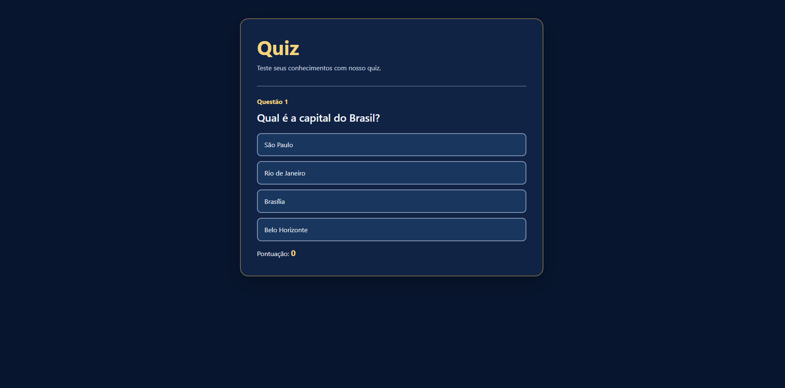

# Quiz interativo com JavaScript

Projeto desenvolvido durante os estudos na **Alura**, no curso
**JavaScript: DOM, eventos e requisições**, para praticar a criação
de uma página interativa com HTML, CSS e JavaScript.

## Objetivo

Construir um quiz que apresenta perguntas, identifica respostas
corretas e incorretas e atualiza a pontuação sem recarregar a
página durante as respostas.

## Propósito da aula

Compreender como o JavaScript interage com os elementos do HTML
por meio do DOM e responde às ações do usuário.

O projeto foi construído por etapas, com testes no navegador,
correção de erros e registro das alterações no Git.

## Funcionalidades

- Botão para iniciar o quiz.
- Exibição progressiva de três perguntas.
- Indicação visual de respostas corretas e incorretas.
- Bloqueio das alternativas após responder cada pergunta.
- Pontuação visível durante o quiz, com **10 pontos por acerto**.
- Botão de finalizar que recarrega a página e reinicia o quiz.

## Ferramentas utilizadas

- **HTML:** estrutura das perguntas, alternativas e placar.
- **CSS:** aparência, espaçamento e estados visuais.
- **JavaScript:** eventos, validação das respostas e pontuação.
- **VS Code:** edição dos arquivos.
- **Live Server:** servidor local com atualização automática.
- **Git:** histórico das etapas do desenvolvimento.
- 
## Aprendizados

- Estruturar uma página HTML e conectar arquivos externos.
- Selecionar elementos com `getElementById` e `querySelector`.
- Selecionar várias alternativas com `querySelectorAll`.
- Manipular classes CSS com `classList`.
- Organizar classes com o padrão **BEM**
  (Block, Element, Modifier).
- Capturar eventos com `addEventListener`.
- Usar `preventDefault()` para evitar o recarregamento no envio
  dos formulários.
- Identificar o botão selecionado com `event.submitter`.
- Verificar a presença de `data-correct` com `hasAttribute`.
- Desabilitar alternativas após uma resposta.
- Atualizar o placar com `textContent`.
- Impedir que uma pergunta some pontos mais de uma vez.
- Reiniciar a página com `window.location.reload()`.
- Registrar alterações com commits.

## Erros e aprendizados do processo

Durante o desenvolvimento, ocorreram erros de digitação e
diferenças entre os seletores do JavaScript e os IDs do HTML.

Exemplos:

- `docment` em vez de `document`.
- `documentquerySelector` em vez de `document.querySelector`.
- `textcontent` em vez de `textContent`.
- Uso de um seletor que não correspondia ao ID do elemento.

Esses problemas reforçaram a importância de ler as mensagens
do console, conferir os nomes e lembrar que JavaScript
diferencia letras maiúsculas de minúsculas.

Também aprendemos a especificar claramente o comportamento
esperado ao solicitar ajuda à IA e a revisar o código gerado.

## Refatoração

A aula apresentou a importância de reduzir código repetido.

Refatorar significa melhorar a organização do código sem alterar
seu comportamento. No quiz, a lógica semelhante dos eventos
das perguntas pode ser reunida em uma função reutilizável.

Depois de uma refatoração, é necessário testar novamente as
respostas, a pontuação e a sequência das perguntas.

## Como executar

1. Abra a pasta do projeto no VS Code.
2. Instale a extensão **Live Server**, caso ainda não esteja instalada.
3. Clique com o botão direito em `index.html`.
4. Selecione **Open with Live Server**.
5. Inicie o quiz no navegador.

## Estrutura do projeto

- `index.html`: estrutura da interface.
- `scripts/quiz.js`: lógica e interações.
- `styles/quiz.css`: estilos visuais.
- `specs/estilos.md`: especificação dos estilos.
- `README.md`: documentação do projeto.

## Créditos

Projeto de estudo baseado nas aulas da **Alura**, com ajustes
realizados durante a prática.
